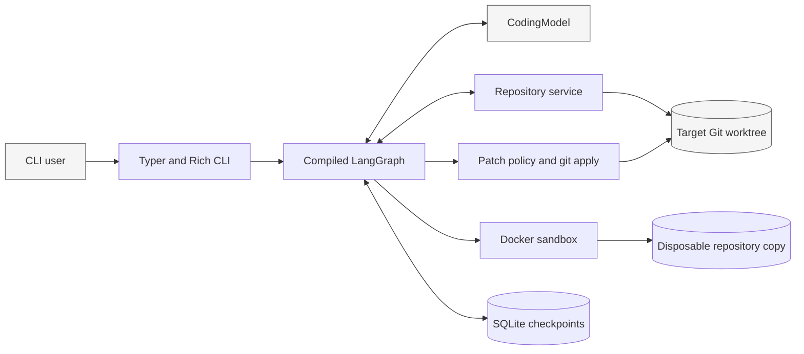
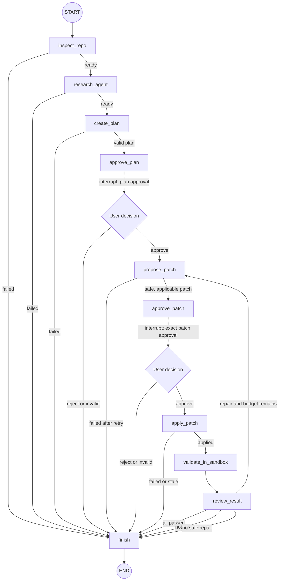
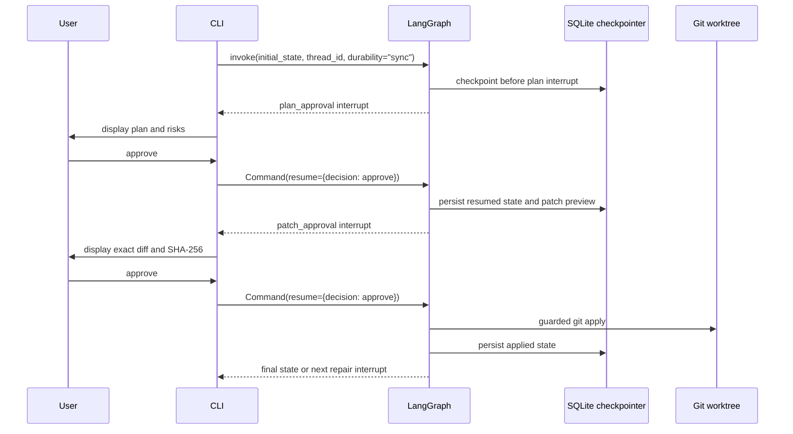
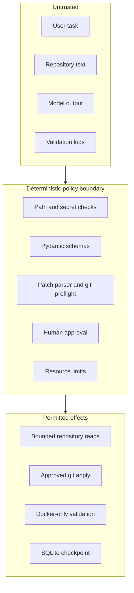

# LangGraph Architecture

This project is a local, single-agent coding workflow built with an explicit
`langgraph.graph.StateGraph`. LangGraph owns orchestration, checkpointing, conditional routing, and
human-in-the-loop pauses. Repository access, patch application, and Docker validation remain
deterministic application services outside the model.

The implementation deliberately does not use a prebuilt ReAct agent. The graph topology is declared
in [`src/coding_agent/graph.py`](../src/coding_agent/graph.py), node behavior lives in
[`src/coding_agent/nodes.py`](../src/coding_agent/nodes.py), and the checkpoint-safe state contract is
defined in [`src/coding_agent/state.py`](../src/coding_agent/state.py).

## Design goals

- Keep model reasoning separate from deterministic effects.
- Require distinct human approval for the plan and every patch, including repairs.
- Persist interrupts so a process can stop and resume with the same thread ID.
- Treat model output and repository content as untrusted data.
- Confine all writes to validated patches and all generated-code execution to Docker.
- Bound research, context, patch size, logs, validation time, and repair attempts.
- Make the workflow testable without network access by injecting the model and sandbox.

## System context



The graph receives constructed `CodingModel`, `Settings`, checkpointer, and `DockerSandbox`
instances. Those live objects are dependencies of the compiled graph, not values in checkpoint
state.

## Graph topology



`research_agent` contains a small bounded model/tool loop, but it is one LangGraph node. Tool calls
are dispatched through an allowlist of `list_files`, `search_text`, and `read_file`; they are not
separate graph nodes and cannot invoke a shell.

## Conditional routing

The graph uses named routing functions rather than allowing the model to select edges directly.

| Source node | State predicate | Destination |
| --- | --- | --- |
| `inspect_repo` | `status == "failed"` | `finish` |
| `inspect_repo` | otherwise | `research_agent` |
| `research_agent` | `status == "failed"` | `finish` |
| `research_agent` | otherwise | `create_plan` |
| `create_plan` | `status == "failed"` | `finish` |
| `create_plan` | otherwise | `approve_plan` |
| `approve_plan` | `plan_approval == "approve"` | `propose_patch` |
| `approve_plan` | otherwise | `finish` |
| `propose_patch` | `status == "failed"` | `finish` |
| `propose_patch` | otherwise | `approve_patch` |
| `approve_patch` | `patch_approval == "approve"` | `apply_patch` |
| `approve_patch` | otherwise | `finish` |
| `apply_patch` | `status == "failed"` | `finish` |
| `apply_patch` | otherwise | `validate_in_sandbox` |
| `validate_in_sandbox` | unconditional | `review_result` |
| `review_result` | `next_action == "repair"` | `propose_patch` |
| `review_result` | otherwise | `finish` |
| `finish` | unconditional | `END` |

Only deterministic state fields control routing. Repository text, validation logs, and model prose
cannot create new edges or bypass approval nodes.

## Node contracts

| Node | Responsibility | Model call | Side effect |
| --- | --- | --- | --- |
| `inspect_repo` | Resolve the Git root, summarize files/configuration, and capture pre-existing changes. | No | Read-only Git/filesystem access |
| `research_agent` | Run bounded read-only exploration and store relevant snippets. | Research/tool selection | Read-only repository tools |
| `create_plan` | Produce and validate a structured `ImplementationPlan`; validate every intended path. | Structured plan | None |
| `approve_plan` | Pause with the plan and dirty-worktree notice; accept only `approve` or `reject`. | No | LangGraph interrupt only |
| `propose_patch` | Refresh intended-file contents, request one unified diff, enforce patch policy, and preflight it. | Structured patch | Temporary patch file and read-only `git apply --check` |
| `approve_patch` | Pause with the exact diff, affected files, description, attempt number, and SHA-256. | No | LangGraph interrupt only |
| `apply_patch` | Recheck approval, patch identity, base hashes, and applicability, then apply and capture `git diff`. | No | The only target-worktree write |
| `validate_in_sandbox` | Run configured commands in a constrained container against a disposable copy. | No | Docker container and temporary copy |
| `review_result` | Convert validation outcomes into completion, unverified finish, partial finish, or a bounded repair. | Only for failed/error/timeout results | None |
| `finish` | Build the stable `final_summary` returned to the CLI. | No | None |

Nodes return partial state dictionaries. `AgentState` does not define automatic reducers, so a
returned key replaces the previous value. Nodes explicitly accumulate values that must survive a
loop, including `errors`, `all_changed_files`, and `validation_history`.

## State design

`AgentState` is a `TypedDict(total=False)` so nodes can return only the fields they own. Structured
model responses use strict Pydantic models with unknown fields rejected.

| State group | Principal fields | Purpose |
| --- | --- | --- |
| Identity/input | `thread_id`, `repo_root`, `task` | Stable execution identity and user request |
| Lifecycle | `status`, `next_action`, `errors` | Routing and terminal reporting |
| Research | `messages`, `repo_summary`, `relevant_files`, `context_snippets`, `research_turns`, `tool_call_count` | Bounded repository understanding |
| Plan | `plan`, `plan_approval`, `preexisting_changes` | Approved scope and user-visible risks |
| Patch | `proposed_patch`, `patch_description`, `changed_files`, `patch_sha256`, `patch_base_hashes`, `patch_approval` | Exact patch approval and stale-write protection |
| Applied changes | `applied_patch_sha256`, `applied_diff`, `all_changed_files` | Idempotency and final reporting |
| Validation/repair | `validation_results`, `validation_history`, `attempt_number`, `max_repair_attempts`, `review_findings`, `repair_instructions` | Docker evidence and bounded repair loop |
| Output | `final_summary` | CLI-facing result |

Secrets, model clients, subprocesses, file handles, SQLite connections, and live repository objects
are never placed in state. Text entering state is bounded and credential-like values are scrubbed.

## Human approval and persistence

Both approval nodes call `langgraph.types.interrupt()`. An interrupt checkpoints graph state and
returns its payload to the CLI. The CLI displays that payload, accepts only `approve` or `reject`,
and resumes with `Command(resume={"decision": decision})`.



LangGraph may re-enter an interrupted node when it resumes. Approval nodes therefore perform no
repository writes before or inside `interrupt()`. The write occurs only in the following
`apply_patch` node after the resumed decision has been validated.

The production graph is compiled with `SqliteSaver`. The CLI always supplies
`config={"configurable": {"thread_id": <uuid>}}` and uses synchronous durability. The checkpoint
database is stored in the application data directory and is rejected if configured inside the
target repository.

On `resume`, the CLI:

1. Rebuilds the same graph with a new model/sandbox instance and the SQLite checkpointer.
2. Loads the snapshot for the thread ID.
3. Verifies that the saved repository matches `--repo`.
4. Resumes a saved interrupt, continues a pending node, or displays an already-terminal state.

## Exact-patch approval invariant

The approved bytes are the only bytes eligible for application:

```text
model proposal
  -> syntax/operation/path/size/secret policy
  -> intended-file allowlist
  -> base file hashes
  -> read-only git apply --check
  -> SHA-256 + exact diff persisted
  -> user sees and approves exact diff
  -> SHA-256 equality check
  -> base hash equality check
  -> second git apply --check
  -> git apply
```

This sequence prevents malformed patches from reaching approval, detects edits made between preview
and application, and refuses a substituted patch. `applied_patch_sha256` additionally prevents the
same graph state from applying an already-applied patch twice.

## Validation and repair loop

Validation never falls back to host execution. `DockerSandbox` copies the repository to a temporary
workspace and invokes a fixed argument vector with network disabled, a read-only container root,
dropped capabilities, a non-root user, CPU/memory/process limits, a timeout, bounded logs, and no
automatic image pull.

`review_result` handles validation deterministically when possible:

- All configured results are `passed`: set `completed` and finish.
- No command ran or any result is `not_run`: set `unverified` and finish.
- A command failed, timed out, or errored: ask the model for a structured `ReviewDecision`.
- A repair is requested and budget remains: increment `attempt_number`, store repair instructions,
  and route to `propose_patch`.
- No repair is appropriate, review fails, or the budget is exhausted: set `partial` and finish.

The initial implementation uses `attempt_number == 0`. At most two repair attempts are allowed by
default. Every repair returns through `approve_patch`, so no earlier approval authorizes a later
diff. Each validation batch is retained in `validation_history`.

## Trust and effect boundaries



- The model can request only three read-only research tools.
- Patch paths are normalized beneath the repository and checked against the approved plan.
- Binary patches, renames/copies, mode changes, protected paths, credential material, and oversized
  patches are rejected.
- The model cannot approve a plan or patch and cannot choose an arbitrary command.
- Only `apply_patch` mutates the target worktree.
- Docker receives a disposable repository copy, not user credentials or the home directory.
- Provider errors, repository content, and logs are scrubbed before persistence or display.

## Terminal statuses

| Status | Meaning |
| --- | --- |
| `completed` | A patch was applied and every configured Docker validation command passed. |
| `unverified` | A patch was applied, but secure validation did not run. |
| `partial` | A patch was applied, but validation/review did not establish success or repairs were exhausted. |
| `failed` | Planning, proposal, or guarded application could not complete safely. |
| `rejected` | The user rejected a plan or patch, or supplied an unrecognized decision. |

`finish` preserves the terminal status and adds `final_summary`; it never converts `not_run` into
success.

## Testability

The outer graph depends on protocols and injected services rather than concrete network clients.
Tests compile the same topology with `FakeModel`, `FakeSandbox`, and `InMemorySaver`; persistence
tests rebuild it with `SqliteSaver`. This covers approval rejection, crash/resume, stale patches,
double resume, validation outcomes, repair approval, repair limits, secret redaction, and the full
workflow without API charges.

The architecture is intentionally single-user and local-first. Multi-agent delegation, arbitrary
shell access, remote repository operations, auto-installation, and unattended approval are outside
the MVP boundary.

