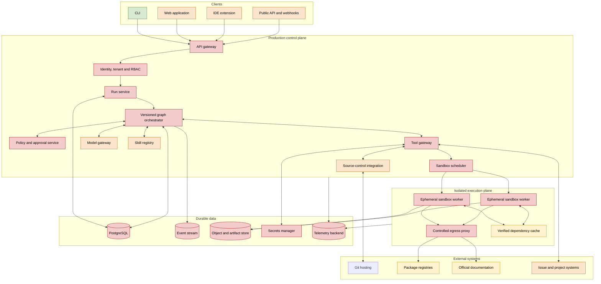

# Future Extensibility and Production Architecture

## Purpose

This document describes how the current local, single-user workflow can evolve into a secure,
multi-language, multi-tenant production coding-agent platform. It focuses on the orchestration
graph, tool and skill systems, language intelligence, sandbox execution, user experience,
operations, governance, and unattended execution.

The recommendations extend the current architecture; they do not replace its strongest property:
model reasoning is separated from deterministic policy and side effects. The existing architecture
is documented in [architecture.md](./architecture.md).

## Capability color legend

The colors below communicate maturity and urgency. The symbol is the source of truth in Markdown
renderers that do not display Mermaid colors.

| Color | Meaning |
| --- | --- |
| 🟩 Green | Present in the current implementation or has a usable baseline |
| 🟨 Yellow | Missing extension needed for broader developer usefulness |
| 🟧 Orange | Missing production capability needed for team or service operation |
| 🟥 Red | Missing critical control; blocks safe multi-tenant or unattended operation |
| 🟦 Blue | Advanced or optional differentiator after the production foundation exists |

## Executive assessment

The current implementation is a sound safety-oriented vertical slice: it has an explicit
LangGraph workflow, bounded repository research, structured planning, exact-patch approval,
workspace-confined patching, durable local checkpoints, Docker-only validation, and a bounded
repair loop. That is an appropriate foundation for a local assistant.

The largest gap is not model capability. It is the service platform around the model. A production
system needs durable distributed orchestration, remote source-control lifecycle management,
language-aware code intelligence, policy-governed tools, hardened elastic sandboxes, identity and
tenant isolation, observable execution, evaluation gates, and a delivery workflow that remains
safe when no person is watching every step.

| Area | Current baseline | Target state | Gap |
| --- | --- | --- | --- |
| Orchestration | One linear graph with one repair loop | Composable, versioned subgraphs with leases, cancellation, compensation, and policy gates | 🟧 Orange |
| Repository access | Existing local Git worktree | Authenticated clone/fetch, ephemeral worktrees, branch and pull-request lifecycle | 🟧 Orange |
| Research tools | Bounded file list/search/read | Symbol, reference, diagnostics, dependency, documentation, registry, and history tools | 🟨 Yellow |
| Editing | Approved unified diff | Structured edits, formatting, conflict recovery, generated-file policy, and multi-commit changesets | 🟨 Yellow |
| Validation | One configured command in local Docker | Language-aware pipelines on hardened, elastic, isolated workers | 🟥 Red |
| Languages | Python-focused, text-based understanding | Pluggable language profiles and polyglot workspace planning | 🟨 Yellow |
| Skills | Prompts and tools are application code | Versioned, permissioned, testable skill packages with provenance | 🟧 Orange |
| Persistence | SQLite checkpoints | Transactional metadata, event log, artifact store, and production checkpointer | 🟥 Red |
| User experience | Interactive local CLI | Web/IDE/API clients with streaming, collaboration, review, and administration | 🟧 Orange |
| Multi-user controls | None | SSO, RBAC/ABAC, tenant isolation, quotas, audit, and retention | 🟥 Red |
| Observability | Terminal report and checkpoint state | Traces, metrics, costs, artifacts, audit evidence, SLOs, and alerting | 🟥 Red |
| Unattended execution | Deliberately unsupported | Policy-scoped autonomy with budgets, risk tiers, protected delivery, and rollback | 🟥 Red |

## Architectural principles

1. **Deterministic systems authorize effects.** A model may propose an action, but policy code,
   identity, repository state, and approval records determine whether it can run.
2. **Every effect is attributable and replay-safe.** Tool calls have an actor, tenant, run, policy
   decision, immutable input, bounded output, and idempotency key.
3. **Repository content is always untrusted.** Source files, issue text, build logs, documentation,
   and tool output can contain prompt injection or misleading instructions.
4. **Autonomy is a policy tier, not a global switch.** Read, edit, execute, publish, and deploy are
   separate capabilities with separate approvals and risk limits.
5. **Sandboxes are disposable execution subjects.** They receive only the minimum code, secrets,
   network routes, resources, and lifetime required for one job.
6. **Artifacts outlive workers; workers do not own state.** Plans, patches, logs, test reports, and
   provenance are stored durably outside graph and sandbox processes.
7. **Language support is configuration plus adapters.** The core graph should not accumulate
   language-specific branches.
8. **Production behavior is measurable.** Quality, cost, latency, safety, and reliability need
   explicit SLOs and regression evaluations.
9. **Human review remains first-class.** A production UI must make plans, evidence, diffs, risks,
   and policy decisions easier to inspect, not merely provide a chat box.
10. **Delivery is separate from implementation.** Producing a valid changeset does not inherently
    authorize a commit, push, merge, release, or deployment.

## North-star system architecture



The control plane makes authorization and orchestration decisions. The data plane executes
untrusted repository code. These planes should use different identities, network policies, and
infrastructure accounts so a sandbox compromise cannot administer the service.

## Graph evolution

### Replace the monolithic workflow with composable subgraphs

The current graph is intentionally small. Production growth should happen through explicit
subgraphs with typed contracts rather than one increasingly connected graph. A recommended
top-level lifecycle is:

```mermaid
flowchart LR
    Intake[Intake and authorize] --> Acquire[Acquire workspace]
    Acquire --> Understand[Understand repository]
    Understand --> Plan[Plan changes]
    Plan --> PlanGate{Plan policy gate}
    PlanGate --> Implement[Implement changeset]
    Implement --> Validate[Validation pipeline]
    Validate --> Review[Independent review]
    Review --> Decision{Quality and risk gate}
    Decision -->|repair| Implement
    Decision -->|approved| Deliver[Delivery subgraph]
    Decision -->|stop| Report[Final evidence]
    Deliver --> Report

    classDef current fill:#d9ead3,stroke:#38761d,color:#000;
    classDef extension fill:#fff2cc,stroke:#bf9000,color:#000;
    classDef production fill:#fce5cd,stroke:#b45f06,color:#000;
    classDef critical fill:#f4cccc,stroke:#990000,color:#000;
    class Plan,Implement,Validate current;
    class Understand,Review extension;
    class Acquire,Deliver production;
    class Intake,PlanGate,Decision,Report critical;
```



Recommended subgraphs and responsibilities:

| Subgraph | Responsibilities | Status |
| --- | --- | --- |
| Intake | Normalize task, authenticate actor, resolve tenant/project, classify risk, set budgets, select policy | 🟥 Red |
| Repository acquisition | Clone/fetch exact revision, verify host/repository allowlist, create isolated worktree, record base commit | 🟧 Orange |
| Repository understanding | Detect workspace topology, languages, build systems, ownership, symbols, dependencies, and relevant history | 🟨 Yellow |
| Planning | Produce structured goals, steps, files, behavior, validation, migration, rollout, and risk plan | 🟩 Green baseline |
| Approval | Resolve required approvers from risk and ownership; support comments, expiry, revision, and delegation | 🟧 Orange |
| Implementation | Apply one or more atomic changesets, format affected code, and preserve provenance | 🟩 Green baseline |
| Validation | Run a dependency-aware build/test/lint/security pipeline with fan-out and aggregation | 🟥 Red |
| Independent review | Review correctness, security, maintainability, API compatibility, tests, and requirement coverage | 🟨 Yellow |
| Repair | Classify failure, choose retry scope, prevent repeated ineffective edits, and enforce budgets | 🟩 Green baseline |
| Delivery | Create branch/commit/pull request, attach evidence, wait for CI, update or abandon safely | 🟧 Orange |
| Cleanup | Revoke credentials, delete sandbox/worktree, release leases, finalize retention, and emit audit record | 🟥 Red |

### State contract required for distributed execution

Large repository content and logs should not be stored directly in graph checkpoints. Store
immutable artifacts and keep references plus hashes in graph state.

| State domain | Required fields |
| --- | --- |
| Identity | `tenant_id`, `organization_id`, `project_id`, `actor_id`, `actor_type`, `auth_context_id` |
| Run identity | `run_id`, `thread_id`, `graph_version`, `state_schema_version`, `parent_run_id`, `correlation_id` |
| Source | `repository_id`, `remote_url_id`, `base_ref`, `base_commit_sha`, `worktree_id`, `head_commit_sha` |
| Policy | `policy_bundle_version`, `risk_tier`, `capability_grants`, `required_approvals`, `approval_expiry` |
| Budget | model tokens, cost, wall time, tool calls, sandbox minutes, repairs, concurrent jobs |
| Control | `status`, `lease_owner`, `lease_expiry`, `cancel_requested`, `deadline`, `next_wakeup_at` |
| Artifacts | content-addressed IDs for context, plan, patch, diff, logs, reports, SBOM, and final evidence |
| Provenance | model/provider/version, prompt version, skill versions, tool versions, policy decisions |
| Delivery | branch, commits, pull request, CI checks, merge eligibility, release/deployment references |

State updates need optimistic concurrency or compare-and-swap semantics. Each effectful node must
have an idempotency key derived from the run, node, attempt, and immutable input hash. This prevents
duplicate commits, sandbox jobs, comments, or pull requests after retry or worker failover.

### Long-running graph behavior

🟥 **Missing production controls:**

- Durable timers for approval expiry, scheduled starts, CI polling, retry backoff, and deadlines.
- Cancellation propagation from run to model stream, tool call, sandbox job, and delivery action.
- Execution leases and heartbeats so another worker can recover an abandoned run safely.
- Node-specific retry policies that distinguish transient infrastructure failures from bad model
  output, policy denial, deterministic test failure, and user rejection.
- Compensation nodes for partially completed external effects, such as closing an abandoned pull
  request or revoking a temporary credential. Git history should be corrected with new commits, not
  destructive rewrites.
- Explicit waiting states for human review, external CI, issue updates, and rate-limit recovery.
- Graph and state-schema migration so runs created by an older release can resume safely.
- Dead-letter handling and an operator workflow for runs that cannot advance automatically.

### Parallelism and specialist reasoning

Parallel work should be introduced only where outputs are independently mergeable and the graph can
resolve conflicts deterministically. Useful fan-out points include repository mapping, independent
test suites, static analysis, security review, and documentation impact analysis.

A future specialist topology can include planner, implementer, test designer, security reviewer,
API-compatibility reviewer, and documentation reviewer. Specialists should be bounded subgraphs,
not an open-ended conversation swarm. Each receives the minimum context and capabilities needed,
returns a typed artifact, and cannot directly publish or approve its own work.

🟥 Production requirements for multiple specialists:

- A deterministic supervisor owns task decomposition, budgets, termination, and merge order.
- Write-capable specialists use isolated branches/worktrees; concurrent writes to one worktree are
  prohibited.
- Findings are deduplicated and ranked by evidence, severity, and requirement coverage.
- A reviewer is independent only if it does not inherit hidden reasoning or untrusted instructions
  from the implementer; it should review the task, diff, code, and evidence.
- The graph detects cyclic delegation, repeated proposals, oscillating patches, and budget abuse.

## Tool platform

### Tool contract

Every tool should be registered through a capability gateway instead of being bound directly to a
model. A production tool declaration should include:

- Versioned name, JSON input/output schemas, owner, and documentation.
- Effect classification: pure read, repository read, workspace write, sandbox execution, external
  write, credential use, or irreversible action.
- Required capabilities, tenant policy, approval class, allowed network destinations, and secret
  scopes.
- Time, output, concurrency, and cost limits.
- Idempotency behavior, cancellation behavior, retry safety, and audit fields.
- Result provenance, truncation metadata, redaction state, content hash, and artifact references.
- A deterministic implementation and contract tests independent of model prompts.

The gateway should reject unknown tools and arguments, resolve policy before dispatch, redact
results, emit telemetry, and return a typed error taxonomy. The model must never receive raw cloud
credentials or a generic host-shell primitive.

### Required tool families

| Tool family | Capabilities | Status |
| --- | --- | --- |
| Repository reading | Bounded list, search, read, path validation, secret scrubbing | 🟩 Green |
| Git transport | Clone, fetch, ref resolution, submodule policy, partial/shallow clone, LFS handling | 🟧 Orange |
| Git workspace | Worktree/branch creation, status, history, blame, diff, merge-base, conflict detection | 🟨 Yellow |
| Structured code navigation | Symbol search, definitions, references, call hierarchy, diagnostics, type information | 🟨 Yellow |
| Structured editing | AST-aware edits, rename, import organization, formatter integration, generated-file detection | 🟨 Yellow |
| Sandbox command runner | Policy-selected command templates, process control, artifacts, reports, cancellation | 🟥 Red |
| Build and test | Discover and run affected tests, unit/integration/e2e suites, coverage and flaky-test classification | 🟧 Orange |
| Package intelligence | Registry metadata, compatible versions, lockfiles, release notes, license and vulnerability data | 🟨 Yellow |
| Documentation search | Time-stamped official documentation with URL, version, excerpt limits, and source provenance | 🟨 Yellow |
| Security analysis | SAST, dependency scanning, secret scanning, IaC/container checks, SBOM generation | 🟧 Orange |
| Source-control delivery | Commit, push, pull request, review comment, checks, merge eligibility | 🟧 Orange |
| Work tracking | Read/update issues, requirements, acceptance criteria, and run links | 🟦 Blue |
| Release operations | Build/sign artifacts, stage releases, deployment proposal, rollback evidence | 🟥 Red until governed |

### Web and package research

A production system needs current information, but unrestricted browsing creates data-exfiltration
and prompt-injection paths. Provide separate tools with explicit trust levels:

1. **Official documentation search** restricts sources to vendor or project documentation and
   records product version and retrieval time.
2. **Package registry lookup** queries first-party registry APIs for versions, release dates,
   deprecation, checksums, supported runtimes, and signatures.
3. **Advisory lookup** queries trusted vulnerability databases and maps results to exact locked
   versions.
4. **Release-note retrieval** fetches a bounded, cited changelog for the proposed version range.
5. **General web search** is optional and read-only; its results are labeled untrusted and cannot
   authorize commands, dependencies, or policy changes.

Dependency upgrades should produce a provenance record: current constraint, selected version,
compatibility basis, release notes consulted, vulnerability/license result, lockfile delta, and
tests run. “Latest” should never be interpreted without checking runtime compatibility, pre-release
status, organization policy, and lockfile reproducibility.

### Command execution

The model may propose a command intent such as “run Python unit tests,” but a deterministic language
profile should map that intent to an approved argument vector. For exceptional commands, use a
separate policy and approval path that displays the exact executable, arguments, working directory,
environment keys, network policy, timeout, and expected outputs.

Commands must run only inside the execution plane. Avoid shell interpolation where possible. If a
shell is required by a trusted build system, launch a reviewed script from the repository under the
sandbox's restrictions and continue to treat it as hostile code.

## Skills and extensibility model

A skill is a versioned workflow package that teaches the platform how to perform a bounded class of
tasks. Skills should compose tools and graph fragments; they should not bypass policy.

### Skill package contract

🟧 A production skill package should contain:

- A manifest with immutable name, semantic version, publisher, supported platform versions, and
  content digest.
- Purpose, activation rules, input/output schemas, required tools, permissions, language profiles,
  and network destinations.
- Prompt resources and structured graph fragments with explicit entry/exit contracts.
- Required human gates, maximum budgets, failure behavior, and cleanup behavior.
- Tests with representative repositories, malicious-input fixtures, expected tool traces, and
  quality assertions.
- Migration notes for stateful skill upgrades and a deprecation policy.
- Signature and provenance, including build source and security review status.

### Skill lifecycle and governance

- Skills are installed into an organization or project registry; they are not fetched dynamically
  because repository text asks for one.
- Administrators approve capabilities separately from installation. A documentation skill should
  not gain repository-write or secret access implicitly.
- Runs pin exact skill versions. Upgrades are evaluated and rolled out progressively.
- The platform records which skill selected each tool and which policy allowed it.
- Tenant-authored skills execute with the same sandboxing, schema validation, redaction, and budget
  limits as built-in skills.
- Conflicting activation rules are resolved deterministically and displayed to the user.
- Skills cannot redefine system policy, approval semantics, audit behavior, or trust labels.

### High-value skill catalog

| Skill | Outcome | Priority |
| --- | --- | --- |
| Bug repair | Reproduce, localize, patch, add regression test, and validate | 🟨 Yellow |
| Feature implementation | Trace acceptance criteria to code, tests, docs, migration, and rollout | 🟨 Yellow |
| Dependency upgrade | Research compatibility/security, update manifests and locks, run focused validation | 🟨 Yellow |
| Test generation | Identify behavior gaps, create stable tests, measure meaningful coverage delta | 🟨 Yellow |
| Code review | Produce evidence-backed, severity-ranked, deduplicated findings | 🟧 Orange |
| Security remediation | Validate advisory reachability, patch safely, create SBOM/evidence | 🟧 Orange |
| Framework migration | Inventory usage, stage transformations, validate compatibility, document rollback | 🟦 Blue |
| Documentation maintenance | Update references and examples from verified code behavior | 🟦 Blue |
| CI repair | Reproduce CI environment, classify infrastructure versus code failure, patch config/code | 🟧 Orange |
| Release preparation | Version, changelog, artifact evidence, approval, and signed delivery proposal | 🟥 Red until governed |

## Language and ecosystem support

### Language profile interface

Language behavior should be supplied through a `LanguageProfile`-style adapter with declarative
metadata and tested implementations for:

- File and workspace detection, including monorepo boundaries.
- Manifest and lockfile parsing.
- Runtime and toolchain version discovery.
- LSP server and syntax parser configuration.
- Formatter, linter, type checker, build, test, coverage, and package commands.
- Test-to-source mapping and affected-test selection.
- Generated/vendor path rules and safe edit rules.
- Dependency registry, advisory source, and license metadata.
- Sandbox image/toolchain digest and dependency-cache strategy.
- Canonical validation stages and result parsers.

The graph asks the workspace analyzer for applicable profiles and receives a validation plan. It
does not branch on file extensions throughout orchestration code.

### Suggested language rollout

| Ecosystem | Minimum useful support | Maturity target |
| --- | --- | --- |
| Python | `pyproject.toml`, lockfiles, pytest/unittest, Ruff, mypy/pyright, packaging and virtual environments | 🟨 Yellow: deepen current baseline |
| JavaScript/TypeScript | npm/pnpm/yarn locks, workspace topology, TypeScript server, ESLint, formatters, Jest/Vitest and build tools | 🟨 Yellow |
| Go | modules/workspaces, `gopls`, format, vet, tests, race detector, module checksums | 🟨 Yellow |
| Rust | Cargo workspaces, rust-analyzer, fmt, clippy, tests, feature matrices and advisory checks | 🟨 Yellow |
| Java/Kotlin | Maven/Gradle, JDK/toolchain detection, language server, unit/integration tests, dependency convergence | 🟧 Orange |
| .NET | solutions/projects, NuGet locks, language services, format, build and test | 🟧 Orange |
| Ruby/PHP | Bundler/Composer, framework test tools, static analysis and formatters | 🟦 Blue |
| C/C++ | CMake/build graphs, compilation database, clangd, sanitizer profiles, platform matrix | 🟦 Blue |
| Infrastructure/config | Terraform, Kubernetes, Dockerfile, YAML/schema validation, policy checks and plan-only execution | 🟧 Orange |

### Polyglot and monorepo concerns

🟧 Production-scale repositories require:

- A workspace graph of packages, services, owners, dependencies, generated outputs, and test
  targets.
- Sparse/partial checkout and incremental indexing for repositories too large to copy wholesale.
- Change-impact analysis to select affected builds and tests without hiding full-suite risk.
- Coordinated edits across API schemas, generated clients, database migrations, and multiple
  languages.
- Module-specific toolchains and sandbox images within one run.
- CODEOWNERS and policy-derived approval routing.
- Explicit handling for submodules, LFS objects, vendored code, generated files, and binary assets.

## Repository and delivery lifecycle

### Remote repository acquisition

The repository service should accept a stable repository identifier, not an arbitrary credentialed
URL. It resolves host, tenant authorization, installation identity, and allowed refs before cloning
an exact base commit into an ephemeral workspace.

🟥 Required controls:

- Short-lived, repository-scoped credentials from a secrets manager or source-control application.
- Host key/TLS verification, URL normalization, redirect restrictions, and repository allowlists.
- Size, object count, LFS, submodule, fetch-depth, and checkout-time limits.
- No credential persistence in Git configuration, remotes, logs, checkpoints, or sandbox layers.
- Base-commit pinning and freshness checks before delivery.
- Separate worktree per run and immutable record of the original tree.

### Changeset and pull-request delivery

Delivery should be a separate graph after implementation passes its quality gate:

1. Rebase or recreate the changeset on the latest permitted base revision.
2. Re-run policy-selected validation if the base changed.
3. Create deterministic, signed commits with an attributable service identity.
4. Push to a namespaced branch with collision and ownership checks.
5. Open or update exactly one pull request using an idempotency marker.
6. Attach task traceability, plan summary, risk, validation evidence, and disclosed limitations.
7. Observe required CI and review state without bypassing branch protection.
8. Merge only if an explicit organization policy permits it; otherwise stop at “ready for review.”

Direct writes to protected branches should remain prohibited. Force-push, history rewriting,
automatic merge-conflict resolution, release publication, and deployment each require distinct
policies rather than inheriting pull-request permission.

## Sandbox and execution scalability

### Isolation tiers

| Tier | Intended use | Isolation | Status |
| --- | --- | --- | --- |
| Local Docker | Developer-only local workflow | Basic container boundary on user's machine | 🟩 Green baseline |
| Hardened remote container | Trusted internal repositories with strict runtime policy | Dedicated nodes, rootless runtime, seccomp/AppArmor, network policy | 🟥 Red |
| User-space kernel or microVM | Untrusted/public repositories and higher-risk execution | gVisor/Kata/Firecracker-class boundary | 🟥 Red |
| Dedicated tenant pool | Regulated or high-sensitivity organizations | Account/VPC/project and key separation | 🟦 Blue |

### Execution-plane architecture

The scheduler accepts a signed job specification rather than an arbitrary command. The specification
contains the source artifact hash, immutable image digest, command template ID, resource limits,
network profile, secret handles, expected outputs, deadline, and idempotency key.

Workers should:

- Start from immutable, scanned, signed images referenced by digest.
- Use an unprivileged user, read-only base filesystem, ephemeral writable volumes, dropped
  capabilities, syscall filtering, process limits, and no host socket mounts.
- Receive a clean source snapshot rather than the control-plane checkout or user home directory.
- Default to no network. Route approved destinations through an authenticated egress proxy with DNS
  and request logging.
- Receive secrets only at execution time, scoped to one job, inaccessible to the model, and revoked
  when the job ends.
- Stream bounded logs while uploading full allowed artifacts separately with malware/secret scans.
- Honor cancellation and hard deadlines, then delete compute and ephemeral storage.
- Produce an attestation containing image digest, inputs, commands, policy, timestamps, resource
  usage, outputs, and exit reason.

### Dependency installation

Automatic installation is unsafe without reproducibility and egress policy. A production design
can support it only when:

- The project has a lockfile or the run explicitly proposes and reviews lockfile creation/change.
- Registries and mirrors are allowlisted; packages are checksum/signature verified where supported.
- Installation occurs only inside the disposable sandbox.
- Private-registry credentials are short-lived, read-only, and isolated from build scripts where
  practical.
- Caches are content-addressed and never shared in a way that leaks private tenant artifacts.
- Package provenance, licenses, vulnerabilities, and resolved transitive versions are captured.
- Builds remain hermetic enough to reproduce or explain cache and network inputs.

### Scale and scheduling

🟥 Production scheduling needs:

- Queue partitioning by tenant, risk tier, runtime, region, and hardware requirements.
- Per-tenant concurrency, CPU, memory, storage, network, time, and cost quotas.
- Fair scheduling so a large repository or organization cannot starve others.
- Warm pools for common verified images without reusing writable tenant state.
- Content-addressed source, dependency, and build caches with poisoning defenses.
- Autoscaling from queue depth and startup latency, including scale-to-zero for expensive pools.
- Retry placement that avoids a failed or suspected-compromised worker.
- Capacity reservations and priority classes for interactive versus background work.
- A reconciliation loop that detects leaked workers, volumes, credentials, and jobs.

## Production control plane

### API and service boundaries

Recommended services can begin as modules in a modular monolith, provided their contracts are
explicit. Split them only when scale, isolation, ownership, or reliability requires it.

| Service boundary | Responsibility | Status |
| --- | --- | --- |
| API gateway | Authentication, request validation, rate limits, streaming, versioned public API | 🟥 Red |
| Identity/tenant service | SSO/OIDC, service identities, organizations, projects, roles, groups | 🟥 Red |
| Run service | Create/cancel/query runs, lifecycle, budgets, ownership, retention | 🟥 Red |
| Orchestrator workers | Execute graph nodes, manage leases/timers, resume events | 🟥 Red |
| Policy/approval service | Capability decisions, approver resolution, signed decisions, expiry | 🟥 Red |
| Tool gateway | Schema validation, dispatch, redaction, audit, idempotency | 🟥 Red |
| Repository service | Source-control identities, clone/worktree, refs, delivery | 🟧 Orange |
| Sandbox service | Schedule, isolate, monitor, attest, and clean execution jobs | 🟥 Red |
| Model gateway | Provider abstraction, routing, budgets, fallbacks, safety and telemetry | 🟧 Orange |
| Artifact service | Content-addressed storage, access control, retention, scanning | 🟥 Red |
| Notification service | User, review, completion, failure, and budget notifications | 🟧 Orange |

### Persistence architecture

SQLite should be replaced before concurrent service operation.

- **PostgreSQL:** tenants, users, repositories, runs, graph metadata, approvals, policies, delivery
  records, budgets, and indexed artifact metadata.
- **Production checkpointer:** graph snapshots with transactional ownership and schema versioning.
- **Object storage:** immutable plans, context bundles, diffs, logs, test reports, coverage, SBOMs,
  and attestations. Use tenant-scoped encryption and signed short-lived download URLs.
- **Event stream/queue:** run events, sandbox jobs, notifications, timers, and integrations with
  at-least-once delivery plus idempotent consumers.
- **Cache:** short-lived coordination, rate limits, and safe computed data; never the sole source of
  truth for approval or audit state.
- **Analytics store:** sanitized operational/product events separated from source content and
  secrets.

Backups, point-in-time recovery, restore drills, regional recovery objectives, data residency, and
cryptographic key rotation are part of the design, not deployment afterthoughts.

### Multi-user and multi-tenant controls

🟥 A production service must add:

- OIDC/SAML SSO, optional SCIM provisioning, MFA inheritance, and service accounts.
- Tenant, organization, project, repository, environment, and run resource hierarchy.
- RBAC for common roles plus ABAC for repository, branch, risk, environment, time, and data class.
- Source-control authorization checks at run creation and again at delivery time.
- Row-level and object-level tenant isolation, tenant-scoped encryption keys where required, and
  tests that intentionally attempt cross-tenant access.
- Per-tenant provider credentials, model allowlists, data-retention policy, quotas, and billing
  attribution.
- Signed, immutable approval records that bind actor, role, artifact hash, decision, policy version,
  timestamp, and expiry.
- Administration for skills, tools, policies, sandbox images, integrations, and audit exports.

## User experience

### Web application

The UI should be an evidence and control surface, not only a conversational transcript.

🟧 Core screens:

- Run creation with repository/ref picker, task, acceptance criteria, autonomy tier, and budget.
- Live graph timeline showing current node, queued work, tool calls, sandbox jobs, waits, and retry
  reasons.
- Repository/context explorer showing why files and symbols were selected.
- Structured plan review with inline comments, requested revisions, risks, owners, and approvals.
- Rich diff review with file tree, syntax highlighting, comments, patch versions, generated-file
  labels, secret/security warnings, and exact approved hash.
- Validation dashboard with commands, environment/image, streaming logs, test reports, coverage,
  security findings, artifacts, and provenance.
- Delivery view for branch, commits, pull request, CI, reviews, and merge eligibility.
- Run history, search, filters, cost/usage, comparisons, retention, and export.
- Organization administration for members, roles, integrations, policies, models, skills, quotas,
  sandboxes, and audit events.

Use server-sent events or WebSockets for live updates, but persist every important transition so a
reconnect reconstructs the view. Accessibility, keyboard diff review, responsive layouts, and clear
trust labels are requirements.

### CLI, IDE, and API

- The CLI should support remote run submission, watch/attach, structured JSON output, cancellation,
  artifact download, and noninteractive CI usage under policy.
- IDE integration should show plans/diffs, diagnostics, selected context, and approval prompts while
  delegating effects to the same backend policy and sandbox services.
- The public API should use idempotency keys, cursor pagination, stable error codes, webhook
  signatures, API versioning, and scoped tokens.
- All clients must render the same immutable approval artifacts and must not invent different
  authorization semantics.

## Unattended and scheduled runs

Unattended execution should be introduced last and enabled per task class. It is a policy mode, not
a prompt instruction or a `--yes` flag.

### Autonomy tiers

| Tier | Allowed behavior | Typical use |
| --- | --- | --- |
| A0: Read only | Inspect, explain, review, and propose; no writes or code execution | Repository questions and review |
| A1: Draft | Create plan and changeset in isolated workspace; human approves every publish action | Normal interactive development |
| A2: Validate | Edit and run approved sandbox pipelines automatically; human approves delivery | Trusted team workflows |
| A3: Deliver | Create/update branch and pull request under policy; human review/merge remains | Low-risk maintenance |
| A4: Merge bounded | Merge only low-risk changes after required CI/reviews and policy evaluation | Highly controlled automation |
| A5: Release/deploy | Separate high-assurance system with staged rollout and rollback | Exceptional, mature operations only |

🟥 Required before A3 or above:

- Task-type allowlists, repository/branch scopes, change-size limits, sensitive-path rules, and
  prohibited operations.
- Risk scoring from code ownership, data/security impact, dependency changes, migrations, public
  APIs, infrastructure, generated files, and validation confidence.
- Token, money, elapsed-time, tool-call, repair, sandbox, and external-write budgets with hard stops.
- No self-approval: implementation, policy evaluation, required review, and protected-branch
  enforcement must remain independent.
- Fresh-base and stale-evidence checks before publish or merge.
- Required test/security/coverage checks and explicit handling of skipped or flaky validation.
- Kill switch at global, tenant, repository, integration, skill, model, and individual-run levels.
- Alerting, dead-letter queue, on-call ownership, and safe replay for failed jobs.
- Rollback or revert plan appropriate to the delivered artifact; database and infrastructure
  changes require stronger gates.
- Progressive rollout with shadow mode, draft-only mode, limited repositories, and measured quality
  before broader authorization.

Scheduled runs need deduplication, missed-schedule policy, concurrency policy, timezone handling,
base-ref selection, and notification ownership. Issue-triggered and dependency-update runs must
authenticate webhook events and collapse duplicate triggers.

## Model platform

### Model gateway

🟧 A model gateway should centralize:

- Provider/model allowlists, capability metadata, regional availability, and tenant configuration.
- Routing by task, language, context size, sensitivity, latency, quality, and cost.
- Streaming, timeouts, retries, circuit breakers, fallback models, and provider rate limits.
- Prompt and schema versions, caching rules, token accounting, and cost attribution.
- Redaction and data-loss prevention before requests; output schema validation after responses.
- Provider data-retention and training-policy enforcement.
- Trace correlation without storing hidden reasoning or unnecessary sensitive content.

Fallbacks must preserve capability and schema requirements. A cheaper or available model is not a
valid fallback if it cannot call required tools or reliably produce the required structured output.

### Context engineering

🟨 Improve repository understanding with:

- Incremental syntax/symbol index keyed by repository and commit.
- Hybrid lexical, symbol, graph, and optional semantic retrieval.
- Query expansion from task entities, failing tests, stack traces, ownership, and recent changes.
- Context provenance: every snippet records file, revision, line range, retrieval reason, and hash.
- Deduplication, relevance scoring, change-aware refresh, and strict token/byte budgets.
- Separate trusted instructions from untrusted repository content with visible delimiters and labels.
- Summaries treated as lossy caches, never authoritative replacements for code used in a patch.

## Security and governance

### Threat model and required controls

| Threat | Required mitigation | Gap |
| --- | --- | --- |
| Repository prompt injection | Trust labeling, constrained tools, policy outside model, injection evaluations | 🟩 Green baseline; expand |
| Secret exfiltration | Least-privilege secret broker, egress controls, DLP/redaction, no secrets in model context | 🟥 Red |
| Sandbox escape | Hardened runtime/microVM, patched hosts, no privileged mounts, detection and worker quarantine | 🟥 Red |
| Cross-tenant access | Strong identity, scoped tokens, row/object isolation, separate execution contexts, adversarial tests | 🟥 Red |
| Supply-chain compromise | Signed images/skills, SBOM, verified packages, trusted registries, provenance and scanning | 🟥 Red |
| Confused deputy | Reauthorize each external action against actor, tenant, repository, ref, and current policy | 🟥 Red |
| Malicious build/test output | Treat logs as untrusted, escape UI, cap output, scan artifacts, never interpret logs as authority | 🟧 Orange |
| Approval substitution | Bind approval to immutable artifact hash and policy; invalidate on content/base change | 🟩 Green baseline |
| Tool/schema abuse | Strict validation, allowlists, canonicalization, resource limits, policy gateway | 🟩 Green baseline; expand |
| Denial of service/cost abuse | Quotas, budgets, fair scheduling, rate limits, timeouts, anomaly detection | 🟥 Red |
| Unsafe delivery | Protected branches, signed commits, independent CI/review, no force push, idempotent publishing | 🟧 Orange |

Perform security review at trust boundaries, not only on prompts. The highest-risk components are
the source-control credential broker, tool gateway, sandbox control plane, artifact authorization,
and cross-tenant data access.

### Data governance

- Classify source, prompts, outputs, logs, telemetry, and artifacts by sensitivity.
- Define tenant-configurable retention and deletion, legal hold, export, and residency.
- Encrypt in transit and at rest; rotate keys and integration credentials.
- Minimize source content in analytics and support telemetry-disabled or private deployments.
- Record subprocessor/model-provider routing for compliance evidence.
- Apply license and intellectual-property policy to generated and retrieved content.
- Build toward SOC 2/ISO-style controls with evidence generated from normal operations rather than
  manual screenshots.

## Observability, tracking, and audit

### Run timeline

Every run should produce an append-only logical event stream. Example event types include:

```text
run.created
policy.evaluated
workspace.acquired
graph.node.started
model.request.completed
tool.call.completed
approval.requested
approval.decided
patch.applied
sandbox.job.completed
validation.aggregated
delivery.pull_request.created
run.completed
```

Events contain IDs and artifact references, not unrestricted source or secrets. Event schemas are
versioned and consumers are idempotent.

### Operational telemetry

🟥 Track at minimum:

- Run success, partial, rejected, canceled, policy-denied, infrastructure-failed, and escaped-defect
  rates.
- Time to first plan, approval wait, implementation time, sandbox queue/start/run time, and total
  completion time.
- Model latency, tokens, retries, schema failures, fallbacks, and cost by tenant/task/model.
- Tool latency, error class, output truncation, denial, and retry rate.
- Sandbox utilization, cold-start time, cache hit rate, timeout/OOM/eviction, and cleanup leaks.
- Patch size, files changed, repair count, test selection, coverage delta, flaky tests, and review
  findings.
- Pull-request acceptance, human edits after generation, merge rate, revert rate, incidents, and
  escaped regressions.

Use OpenTelemetry-compatible traces, metrics, and logs with correlation across API, graph, model,
tool, sandbox, and delivery calls. Define SLOs for API availability, run durability, interactive
latency, sandbox startup, and event delivery. Alert on symptoms that affect users, then retain
lower-level diagnostics for investigation.

### Audit trail

The audit trail is separate from ordinary logs and should be append-only or tamper-evident. It must
answer who requested, viewed, approved, changed, executed, published, merged, configured, or deleted
what; under which identity and policy; against which immutable artifact; and when. Audit export must
respect tenant boundaries and retention obligations.

## Reliability and failure management

🟥 Production readiness requires deliberate handling of:

- Process crash during every graph node and between an external effect and its checkpoint.
- Duplicate queue delivery and delayed or out-of-order events.
- Provider timeout, malformed structured output, rate limiting, and regional outage.
- Git host outage, credential revocation, branch movement, and merge conflicts.
- Sandbox queue exhaustion, image startup failure, worker loss, OOM, disk exhaustion, and timeout.
- Database failover, object-store inconsistency, event-stream backlog, and cache loss.
- User cancellation during model generation, tool execution, validation, approval, and delivery.
- Policy or skill update while a run is paused.

Use bounded exponential backoff with jitter for transient failures, but never retry irreversible or
externally visible actions without idempotency. Maintain reconciliation jobs for running workflows,
sandbox resources, source-control branches/pull requests, expiring approvals, and temporary secrets.

## Quality and evaluation system

Unit tests with fake models remain necessary but are not sufficient. A production evaluation
program should include:

| Evaluation layer | Examples | Status |
| --- | --- | --- |
| Deterministic unit/contract | Path policy, schemas, diff application, tool contracts, state migration | 🟩 Green baseline |
| Graph simulation | Every route, retry, interruption, cancellation, duplicate event, crash boundary | 🟨 Yellow |
| Repository task benchmark | Curated bugs/features across languages with objective tests and hidden checks | 🟧 Orange |
| Safety benchmark | Prompt injection, secret theft, path escape, malicious package/build, policy bypass | 🟧 Orange |
| Sandbox adversarial | Escape attempts, fork bombs, disk/network abuse, artifact attacks, cleanup | 🟥 Red |
| Integration certification | Real Git hosts, registries, model providers, identity, queues, storage | 🟧 Orange |
| Load/soak/chaos | Tenant fairness, queue spikes, worker loss, provider outage, database failover | 🟥 Red |
| Online quality | Acceptance, human correction, reverts, incidents, cost and latency | 🟥 Red |

Pin benchmark repositories and toolchains. Score task correctness with tests and requirement checks,
not model self-assessment. Require regression gates for model, prompt, skill, tool, language-profile,
policy, and sandbox-image changes. Use shadow evaluation before changing production routing.

## Phased roadmap

### Phase 0: Fortify the local core

Goal: make the existing vertical slice easier to extend without changing its trust model.

- Introduce artifact references and explicit state/graph version fields.
- Define typed tool results and error taxonomy.
- Split current nodes into small subgraphs with contract tests.
- Add cancellation, deadlines, idempotency tests, and state migration tests.
- Add repository history/symbol tools and a language-profile interface for Python.
- Add documentation and package-registry research with provenance.

Exit gate: local workflows are replay-safe, versioned, observable, and extensible through tested
interfaces.

### Phase 1: Rich local developer workflow

Goal: broaden usefulness while keeping one user and local execution.

- Remote URL clone into a disposable local worktree with explicit credentials outside model state.
- Python plus JavaScript/TypeScript and Go language profiles.
- LSP/syntax-aware navigation, affected tests, multiple validation stages, and richer reports.
- Versioned local skills and a small reviewed skill catalog.
- Optional branch/commit generation, still without automatic push.

Exit gate: representative polyglot repositories can be changed and validated reproducibly with
clear provenance.

### Phase 2: Team service beta

Goal: support authenticated teams with remote execution and human-reviewed delivery.

- API gateway, web UI, SSO, organizations/projects, RBAC, PostgreSQL, object storage, and event bus.
- Remote hardened sandbox pool with scheduler, quotas, egress controls, and attestations.
- Source-control application integration and pull-request creation.
- Policy/approval service, audit trail, telemetry, cost tracking, and administrative controls.
- Draft-only or human-approved delivery; no automatic merging.

Exit gate: tenant isolation, recovery, load, security, and audit tests pass; operators have SLOs and
runbooks.

### Phase 3: Production platform

Goal: meet reliability, security, governance, and scale requirements for general availability.

- Multi-region or defined disaster recovery, backup/restore drills, key rotation, data governance.
- Model gateway, skill registry, language ecosystem expansion, security scanning, and SBOMs.
- Fair scheduling, warm pools, safe caches, reconciliation, dead-letter handling, and kill switches.
- Complete evaluation gates, canary releases, incident response, capacity planning, and support
  tooling.

Exit gate: agreed availability, durability, latency, isolation, quality, and cost SLOs are measured
and consistently met.

### Phase 4: Policy-bounded unattended operation

Goal: automate carefully selected low-risk workflows.

- Scheduled and event-triggered runs, risk classification, autonomy tiers, and hard budgets.
- Automatic pull-request updates for approved task classes.
- Optional bounded merge only after independent reviews, required CI, fresh-base validation, and
  branch protection.
- Progressive rollout, shadow mode, automated rollback/revert preparation, and continuous quality
  monitoring.

Exit gate: unattended changes have demonstrably low revert/incident rates, complete evidence, and
an immediate organization-wide kill switch.

## Prioritized capability backlog

### P0: blockers for any hosted multi-user service

- 🟥 Identity, tenant isolation, scoped authorization, and immutable audit.
- 🟥 PostgreSQL/checkpointer, object store, event queue, leases, and idempotency.
- 🟥 Hardened remote sandbox service, controlled egress, secret broker, cleanup, and attestation.
- 🟥 Tool gateway and policy/approval service.
- 🟥 API security, quotas, budgets, cancellation, retention, backup, and recovery.
- 🟥 Observability, SLOs, alerting, operator tooling, and incident response.

### P1: required for a strong team product

- 🟧 Remote repository and pull-request lifecycle.
- 🟧 Web review UI and streaming run timeline.
- 🟧 Model gateway, artifact provenance, language profiles, and sandbox validation pipelines.
- 🟧 Versioned skill registry and organization administration.
- 🟧 Security/dependency scanning and evaluation gates.

### P2: quality and breadth

- 🟨 LSP/symbol intelligence, structured edits, affected-test analysis, and monorepo graph.
- 🟨 Official documentation/package/advisory research.
- 🟨 More languages, frameworks, task-specific skills, and IDE integration.
- 🟨 Independent specialist reviews with deterministic aggregation.

### P3: advanced automation

- 🟦 Large-scale indexing, organization knowledge retrieval, and advanced migration skills.
- 🟦 Dedicated tenant execution pools and private regional deployments.
- 🟦 Policy-bounded auto-merge, release preparation, and staged deployment integrations.

## Production-readiness definition

The platform is not production-grade merely because it can solve coding tasks. It is production-
ready when all of the following are true:

- Every model/tool/sandbox/external action is authenticated, authorized, bounded, observable,
  attributable, and replay-safe.
- A malicious repository cannot access another tenant, host resources, unrestricted network, or
  long-lived credentials.
- Runs survive process and worker failure without duplicating external effects.
- Users can understand and review the exact plan, changes, evidence, risk, policy, and delivery
  state.
- Quality and safety regressions are blocked by representative offline and adversarial evaluations.
- Operators have capacity models, SLOs, alerts, runbooks, reconciliation, backups, and tested
  recovery procedures.
- Data retention, deletion, residency, encryption, audit, and provider-use policies are enforceable
  per tenant.
- Unattended capabilities are narrow, policy-scoped, budgeted, reversible where possible, and can
  be disabled immediately.

## Decisions to avoid prematurely

- Do not begin with dozens of microservices; begin with clear service boundaries and extract them
  when isolation or scale justifies it.
- Do not use unrestricted shell access as a shortcut for missing tools.
- Do not treat a larger context window as a replacement for repository indexing and provenance.
- Do not let every specialist write to the same workspace.
- Do not store large source/log payloads in graph checkpoints.
- Do not equate a passing generated test with task correctness; require independent acceptance
  evidence.
- Do not allow model confidence to replace policy, approvals, branch protection, or validation.
- Do not introduce unattended merging before tenant isolation, audit, sandbox hardening, evaluation,
  and kill switches are mature.

The safest evolutionary path is to retain the current deterministic effect boundary, make graph
and tool contracts production-grade, build an isolated execution plane, and only then expand
autonomy.
